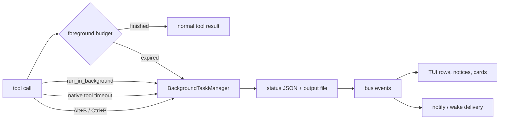

# Background tasks

A background task is a tool call that jcode keeps running after the model's
foreground call returns. The task manager owns the work, writes its output and
status to disk, publishes lifecycle events, and lets the agent continue on
independent work. The TUI is a projection of those events, not the owner of the
process.

This is separate from `jcode server`, which is the long-lived daemon that hosts
sessions. A background task runs inside that daemon unless a `bash` command was
explicitly persisted as a detached process across a reload.

## Quick model



The important distinction is **handoff** versus **execution timeout**. Handoff
does not kill or restart the operation. It transfers ownership of the still
running future or process to the task manager. A tool's own timeout is separate
and may still cancel the work.

## How work becomes a background task

| Trigger | What happens |
| --- | --- |
| `bash` with `run_in_background: true` | Spawns a managed task immediately. The command runs with its own process group, output is streamed to the task file, and the optional `timeout` kills the group if exceeded. |
| Agent-wide automatic handoff | In streaming, nonstreaming, and SDK tool paths, the agent waits up to `tools.auto_background_timeout_ms` (default 3000 ms). If the tool is still running, it is adopted as a background task. |
| `bash` foreground timeout | A foreground `bash` call has its own `timeout` parameter (default 120000 ms, capped at 600000 ms). On expiry the daemon adopts the still running command instead of killing it. |
| `agentgrep` foreground budget | The search tool has a 5 second native foreground budget, then adopts the running search. This is independent of `auto_background_timeout_ms`. |
| Manual handoff | While a tool is running, `Alt+B` or `Ctrl+B` sends a background request to the server. The server signals the current tool wait, and the agent adopts the tool. |
| Reload persistence | On Unix, a reload-persistable foreground `bash` command is already spawned as a detached process group. If a reload arrives, the daemon registers it as a background task instead of interrupting it. |

Two operations are deliberately excluded from automatic handoff:
`ask_user_question` (and the legacy `ask_user` name) because it waits on a human,
and `bg action="wait"` so waiting on a dependency does not recursively
background the wait. Manual handoff and other explicit signals still work.

When automatic handoff fires, the tool result tells the model the task ID and
where the files are, plus this guidance: continue independent work, and if
nothing independent remains, wait rather than poll. It also warns not to rerun
the command, because the first copy is still running.

## Lifecycle

1. The manager reserves a task ID and paths for `<id>.status.json` and
   `<id>.output`.
2. It writes an initial `running` status and, when `notify` is enabled,
   publishes a background-started UI activity.
3. The task runs. Spawned tasks execute a closure that writes output to the
   output file. Adopted tasks wrap an existing `JoinHandle<ToolOutput>`.
4. Progress updates replace the status file's `progress` object and append to a
   bounded event history (50 events).
5. On completion, supersession, or failure, the manager writes a terminal
   status and publishes `BackgroundTaskCompleted`. Cancellation writes a
   terminal `failed` status but does not publish that completion event.
6. When `notify` is enabled, the server fans completion out to attached clients.
   When `wake` is enabled, it starts or interrupts a turn. The client updates
   its retained row and status notice from those events.

A task is terminal when its status is `completed`, `superseded`, or `failed`.
`superseded` is currently used by self-dev build reconciliation, where a build
finished but newer source state made its result obsolete.

The TUI row model has three visual states only: running, completed, and failed.
A superseded task is therefore shown with the failed row treatment even though
the underlying task status remains `superseded` and `bg status` reports it
accurately.

## Storage and ownership

The default task directory is `std::env::temp_dir()/jcode-bg-tasks`, so it
usually resolves to `$TMPDIR/jcode-bg-tasks` on Unix and the user temp directory
on Windows. Each task has:

- `<task_id>.status.json`: task metadata, status, exit code, error, timing,
  progress, delivery flags, event history, and ownership metadata.
- `<task_id>.output`: stdout/stderr and the final exit line.

Task IDs are short and unique: a timestamp suffix plus a few random characters.
The directory is shared by every jcode process on the machine, so status files
include `owner_pid` and a per-process `owner_instance` token. Those fields let a
new server distinguish "this task is still bootstrapping in my process" from
"the PID survived an exec reload but the future that owned this task is gone".
Files without owner metadata are left alone rather than guessed at.

Ownership has two modes:

- **In-process**: the daemon holds the future in its live task map. Cancellation
  aborts the future, which drops children marked `kill_on_drop`.
- **Detached**: a reload-persistable `bash` process has a `pid`, `detached:
  true`, and no owner. It deliberately outlives the server. Completion is
  reconciled by checking process liveness and reading the exit marker from the
  output file.

On server reload, live in-process tasks are aborted and their status files are
finalized as failed with a clear "interrupted by server reload" error. Without
that, the task futures would vanish during exec and their children would keep
running with status files stuck on `running`. At startup, a reconciliation sweep
marks provably orphaned non-detached running tasks as failed. Detached tasks and
unowned legacy files are not clobbered.

Detached `bash` output is not read by an in-process pipe. A follower polls the
output file while the task is running, parses progress markers, and performs a
final drain after the task leaves `running`.

## Progress reporting

The `bash` tool recognizes progress from both explicit markers and ordinary
output. Explicit markers are the reliable interface.

```text
JCODE_PROGRESS {"percent":42,"message":"Compiling jcode"}
JCODE_PROGRESS {"current":7,"total":20,"unit":"tests","message":"integration"}
JCODE_PROGRESS {"kind":"indeterminate","message":"waiting for lock"}
JCODE_CHECKPOINT {"message":"database migrated"}
JCODE_CHECKPOINT plain text checkpoint
```

Accepted `JCODE_PROGRESS` fields include `percent`, `message`, `current`,
`total`, `unit`, `eta_seconds`, `kind`, and `checkpoint`. `kind` may be
`indeterminate`; `checkpoint: true` or `kind: "checkpoint"` turns the update
into a checkpoint event. A plain `JCODE_CHECKPOINT` payload is also accepted as
a message.

For a managed background `bash` spawned with `run_in_background`, a line that
parses as a progress or checkpoint update is consumed and is not written to the
output file. Other lines are written normally, with stderr prefixed by
`[stderr] `. For foreground `bash`, the line is still part of the normal command
output, and the latest parsed update is retained so a timeout promotion starts
the task at the real percentage instead of 0%. A detached reload-persisted
command writes its own output file, so its marker lines remain in the file even
though the follower also parses them.

Without explicit markers, the parser also recognizes:

- `42/100`, `7 of 20 tests`, and byte ratios such as `1.5/4 GiB`
- percentages such as `42%`
- phase prefixes such as `Compiling`, `Downloading`, `Building`, `Linking`,
  `Resolving`, `Fetching`, and `Installing`

Progress is normalized before storage. Measurable counts are authoritative, so
`current: 2, total: 10` overrides a contradictory `percent: 80`. Percentages are
clamped to 0-100, and an indeterminate update that carries a measurable percent
becomes determinate.

Progress updates are persisted in the status file and published on the bus.
`bg wait` returns on the first progress or checkpoint event by default, which is
why a progress-reporting task can make a wait return before completion. Set
`return_on_progress = false` to wait for a terminal status only.

## Notifications, wake, and stalls

Completion delivery has two independent flags:

- `notify`: send a completion notification to attached clients.
- `wake`: start an idle turn, or interrupt a busy turn, so the agent can react.

`wake` implies `notify`. Delivery is normalized to `(notify || wake, wake)`, so
asking for a wake without notification still produces the notification.

Defaults differ by entry point:

| Entry point | `notify` | `wake` |
| --- | --- | --- |
| `BackgroundTaskManager::spawn` | true | false |
| `bash run_in_background` | true (false if explicitly set) | false |
| Automatic handoff / manual handoff | true | false |
| `bg watch` / `delivery` / `subscribe` | true | true |
| Stall watchdog | true | true |

In `[server] wake_mode = "internal"` (the default), the daemon executes the wake
itself: it runs a live turn if the session is idle, otherwise queues a soft
interrupt tagged `BackgroundTask`. In `wake_mode = "external"`, the daemon does
not start or interrupt a turn. It emits a typed `WakeRequested` event and leaves
scheduling to the operator.

A stall watchdog is opt-in and independent of normal completion delivery. Arm it
with `stall_wake_seconds` on `bash` or `bg watch`. The minimum window is 30
seconds. The watchdog fires when a running task produces no new output bytes and
no new progress/event records for the window. Activity resets the countdown, and
it fires at most once per silence episode, re-arming if activity resumes. A stall
is a "check on me" signal, not a terminal status: the task is still running.

## The `bg` tool

`bg` is an agent-facing tool, not a separate top-level `jcode bg` CLI command.
Task artifacts can always be inspected directly in the task directory.

| Action | Purpose |
| --- | --- |
| `list` | List tasks. Defaults to all sessions; use `session_only: true` to scope it. |
| `status` | Show metadata, progress, delivery flags, and recent events. Defaults to the current session when resolving an omitted ID. |
| `output` / `tail` | Read the full output or the last N lines. |
| `wait` | Block until a task finishes, reports progress or a checkpoint, stalls, or the wait times out. Default 60 seconds, capped at 3600. |
| `cancel` | Abort an in-process task, or terminate a detached process group. Detached cancellation sends TERM, waits for the grace period (default 400 ms), then sends KILL on Unix. |
| `cleanup` | Remove old task files. Default 24 hours; running tasks are skipped. |
| `watch` / `delivery` / `subscribe` | Change `notify`, `wake`, and optionally arm the stall watchdog without blocking. |

If `task_id` is omitted, `bg` uses the only matching running task in the current
session. With multiple matches it requires `task_id`, `task_ids`, or
`latest: true`. Multi-task waits support `wait_mode: any`, `all`, or
`first_failure`.

Cancellation is a terminal failure with error `Cancelled by user`. Completion
notifications include a short output preview (up to 500 characters); the output
file remains the source of truth.

`bg cancel` writes the terminal status but does not publish the completion
event. Confirm cancellation with `bg status` instead of relying on a completion
card.

## How the TUI shows it

The TUI keeps a small in-memory row for each task in the active session. Rows are
fed by lifecycle events, so a remote client sees tasks that run in the server
process, not only tasks spawned locally. The process-local manager snapshot is
used as a fallback when no session rows exist.

### Background card

The main display is the `BackgroundTasks` info widget, drawn as a margin card:

```text
⏳ Background · 2 running
◌ cargo test  ━━━╺──  42%
✓ cargo build  ━━━━━━ 100%
```

- `◌` running, `✓` completed, `×` failed.
- A six-cell bar renders determinate progress. Failed rows show `failed`
  instead of a percentage.
- Rows are ordered most recently active first. The standalone widget shows up
  to 6 rows and collapses the rest into `+N more`; the compact Overview form
  shows up to 3.
- At most 8 task rows are retained. Successful completed rows disappear after
  12 seconds, failures stay visible up to the retained limit, and running rows
  always stay.
- A determinate update followed by a phase-only update keeps the last known
  percentage instead of dropping to zero.
- The card is a left-side widget at priority 10 and can merge into `Overview`
  when other compatible sections are present. See `INFO_WIDGET.md` for placement
  and merging rules.

`alt+i` toggles the info widget by default
(`keybindings.info_widget_toggle`). The task itself is unaffected if the widget
is hidden, off screen, or has no room.

### Pinned todo card

The pinned todo card is not a general background-task list. It shows a task only
when an incomplete todo has that task ID in `waiting_on`. The row uses the todo
row's label and the latest percent from the retained task row. Swarm awaits use
the same presentation. This is why a task can appear under a todo lane while
also appearing in the Background card.

### Transcript, status line, and title

- When `notify` is enabled, completion is shown as a status notice and a row
  update. When the completion is injected into the conversation (for example
  with `wake`), the transcript renders a compact completion card: a successful
  task becomes one line with the label and duration, while a failure includes
  exit and diagnostic detail.
- `bg` progress can also update the transient status notice without adding a
  transcript message.
- The terminal title and herdr integration count running rows as delegated work.
  A session with running background tasks reports `working`, not `idle`, even
  when its own turn has ended.
- On reload, persisted detached tasks are surfaced with a note so the agent
  knows a previous shell command is still running.

## Configuration

```toml
[tools]
# Foreground time before the agent hands any eligible tool to the background.
# Default 3000 ms. Set 0 to disable generic automatic handoff.
auto_background_timeout_ms = 3000

[server]
# "internal" starts/interrupts turns in the daemon.
# "external" emits wake_requested and leaves scheduling to the operator.
wake_mode = "internal"
```

`JCODE_WAKE_MODE` overrides `wake_mode`. `auto_background_timeout_ms` does not
disable explicit background requests, native tool budgets, or tool timeouts.
See `TOOL_BACKGROUND_TIMEOUT.md` for the configuration edge cases.

## Failure and reload behavior

- **Server crash or reload**: in-process tasks are finalized as failed during a
  planned reload, or reconciled at startup after a crash. The error names the
  interruption. Detached `bash` tasks continue and are reconciled from their PID
  and exit marker.
- **No attached clients**: the task still runs and writes files. When `notify`
  is on, notification fanout logs a warning if no client receives it.
- **`notify = false` and `wake = false`**: completion is written to disk but no
  completion notice is sent to attached clients. A remote client that tracks
  rows from notifications can retain the last running row until another event
  or reload. `bg status` is authoritative.
- **Cancellation race**: the manager serializes status writes so a stale
  `running` snapshot cannot overwrite a terminal status.
- **Output growth**: the task output file is not trimmed by the manager. Use
  `bg cleanup` or remove old files from the task directory.
- **Malformed progress**: unparsable `JCODE_PROGRESS` JSON is ignored as a
  marker and the line is treated as ordinary output. Heuristic parsing errors
  are reported as a warning in the output file.

## Code map

| Area | Location |
| --- | --- |
| Task manager, wait, cancel, progress, persistence | `crates/jcode-base/src/background.rs` |
| Status file model and progress normalization | `crates/jcode-base/src/background/model.rs`, `crates/jcode-background-types/src/lib.rs` |
| Cleanup | `crates/jcode-base/src/background/cleanup.rs` |
| `bg` tool | `crates/jcode-app-core/src/tool/bg.rs` |
| Automatic handoff policy | `crates/jcode-app-core/src/agent/tool_handoff.rs` |
| Streaming tool handoff | `crates/jcode-app-core/src/agent/turn_streaming_mpsc.rs` |
| `bash` background and progress parsing | `crates/jcode-app-core/src/tool/bash.rs` |
| `agentgrep` native foreground budget | `crates/jcode-app-core/src/tool/agentgrep.rs` |
| Completion, stall, and wake dispatch | `crates/jcode-app-core/src/server/background_tasks.rs` |
| Manual `Alt+B` request handling | `crates/jcode-app-core/src/server/client_lifecycle.rs` |
| TUI retained rows and card | `crates/jcode-tui/src/tui/app/state_ui_messages.rs`, `crates/jcode-tui/src/tui/info_widget_swarm_background.rs` |
| TUI event handling | `crates/jcode-tui/src/tui/app/local.rs`, `crates/jcode-tui/src/tui/app/remote/server_events.rs` |
| Todo dependency rows | `crates/jcode-tui/src/tui/app/todos_view.rs` |
| Message formatting and parsing | `crates/jcode-base/src/message/notifications.rs` |

## Related docs

- `INFO_WIDGET.md`: widget placement, priority, and Overview merging.
- `TOOL_BACKGROUND_TIMEOUT.md`: `auto_background_timeout_ms` details.
- `TODO_TASK_LIST.md`: `waiting_on` and todo dependency behavior.
- `SWARM_ARCHITECTURE.md`: managed agents and swarm awaits.
