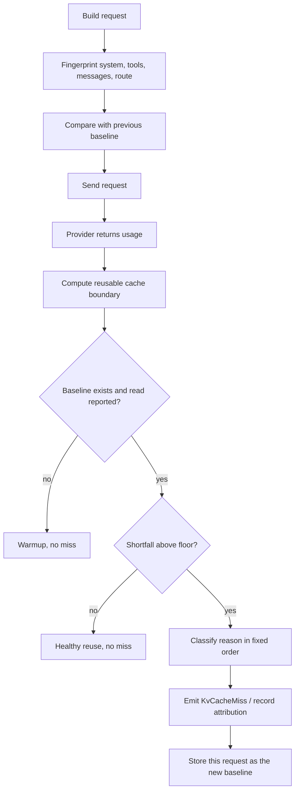

# KV cache watcher

The "KV cache watcher" is jcode's prompt-cache telemetry. It reports how much of
each request the provider served from its server-side prompt cache, and it
classifies the requests that did not reuse the previous prefix.

This is about the **provider's** cache, not a local disk or memory cache. The
provider keeps the processed prompt prefix for a short retention window. A later
request that starts with the same bytes can skip that work. jcode does not
control that cache. It observes the cache counters the provider returns and
compares request fingerprints so a human can see whether reuse is working.

## What the numbers mean

Every provider request sends a prefix: the system prompt, the tool definitions,
and the messages so far. Providers report some subset of:

| Counter | Meaning |
| --- | --- |
| cache read | Tokens the provider served from its prompt cache |
| cache creation | Tokens the provider wrote into its cache for this request |
| input | Tokens the provider processed. The meaning depends on the provider |
| output | Generated tokens, unrelated to prompt cache |

There are two different accounting conventions in the code, and they must not be
mixed:

- **Split accounting** (Anthropic/Claude): `input` is only the uncached
  remainder, while cache-read and cache-creation tokens are separate. The true
  prompt size is `input + cache_read + cache_creation`.
- **Subset accounting** (OpenAI-style): cached tokens are already included in
  `input`. The prompt size is just `input`, and adding the cache read again would
  double count it.

`effective_prompt_tokens` resolves that per provider in
`crates/jcode-compaction-core/src/lib.rs`. Every ratio below uses it, so the
numerator and denominator describe the same request.

Two ratios are exposed:

- **hit** = cache-read tokens divided by effective prompt tokens. This is the
  share of everything sent that came from cache.
- **yield** = cache-read tokens divided by the previous request's reusable cache
  boundary. This is the share of the cacheable prefix that was actually reused.
  It is the fairer measure when the current request adds a large new tail,
  because that new tail could not have been in the cache yet.

A restored session may have cache totals but no historical reusable-boundary
sum. In that case only the observed **hit** ratio is available, and the UI says
`hit`, not `yield`.

A **miss** is not simply a cache read lower than the current prompt. It is a
shortfall against the previous request's reusable cache boundary, above a noise
floor. The first request with no baseline is a warmup, not a miss. Missing cache
telemetry is never a miss.

## Where to see it

| Surface | Shows | Where |
| --- | --- | --- |
| `/cache stats` | Full per-session diagnostics: route, retention, totals, ratios, baseline, recent attributions | Typed in the TUI |
| Inline notice | One classified miss or refresh, attached under the response it describes | Transcript |
| Live status line | A warning while a cache miss is already visible in streaming usage | During a turn |
| Cache countdown | `⏳ cache 9m (...)` before expiry, `🧊 cache cold (...)` after it | Status line while idle |
| Logs | `KV_CACHE_USAGE`, `KV_CACHE_MISS`, `KV_CACHE_REFRESH` | `~/.jcode/logs/` |

The old docked KV cache margin panel is no longer placed in the TUI layout. Its
renderer and tests still exist in `info_widget_cache.rs`, but
`WidgetKind::KvCache` is not in `WidgetKind::all_by_priority()` and is not merged
into `Overview`. `/cache stats` is the supported full report.

### `/cache stats`

`/cache` and `/cache status` are aliases. The report is deliberately raw and
split into sections:

- **Current route / settings**: active provider and model, the Anthropic TTL
  setting, the active route's retention and whether it is a hard TTL or an
  estimate, and whether the expiry notification is active.
- **Session token totals**: client-observed and history totals, cost, context
  limit, and the source of each total.
- **Provider cache telemetry totals**: reported input, cache read, cache write,
  the reusable boundary sum, `cache_read_pct_of_effective_prompt`,
  `cache_write_pct_of_effective_prompt`, and
  `cache_read_pct_of_optimal_input` (when remote history has no cache reads).
  Values including unrecorded live usage are listed next to the committed ones.
- **Current / live stream counters**: the in-flight request's input, output,
  cache read, cache creation, whether usage has been recorded, and stream state.
- **KV cache tracker state**: the current turn and call index, the baseline
  stored for this session, and the pending request fingerprints. The baseline
  includes provider, model, account, upstream, TTL, and signature hashes.

If a field says `unknown`, the data was not reported. It is not zero.

### Inline notices

A classified miss is rendered as a system notice attached to the preceding
response. The full notice looks like this:

```
ℹ️ KV cache miss [low read] [prefix unchanged] turn 4 call 2: 3K cached / 20K expected tokens: ~17K tokens resent (provider read 3K of the 20K-token prefix 41s after the previous call, within TTL 5m; no detected change to provider, model, account, system prompt, tools or message prefix; cause unconfirmed). See KV_CACHE_USAGE in logs.
```

The transcript footer condenses it to one line:

```
╰ 17K KV cache miss · low read · prefix unchanged · 15% hit
```

`expected tokens` is the previous request's reusable boundary, not the current
prompt size. `% hit` in the footer is `cached / expected`. The footer color is
dim below 10K missed tokens, warning at 10K or more, and error at 50K or more.
A malformed or missing amount is treated as warning, never as a small loss.

Harness-caused changes use `⚠️` unless a documented invalidation explains them.
Everything else uses `ℹ️`. Provider-native compaction and the Anthropic daily
rollover are labeled `KV cache refresh`, not `KV cache miss`, because rebuilding
the cache is expected.

Notices are controlled by `features.kv_cache_miss_notices` (default `true`) and
the `JCODE_KV_CACHE_MISS_NOTICES=0` environment override. The detector still
records misses when notices are off, and `/cache stats` still shows them.

### Status line

During a streaming turn, if usage shows an explicit cache problem, the status
line inserts a compact warning such as `⚠ 17k cache miss ·`. It only fires for
providers whose cache telemetry is trustworthy for that signal, and only on a
multi-turn conversation with a warm baseline.

While idle, a known (non-estimate) TTL produces:

- `⏳ cache 9m (20K tok)` during the warning window. The window is 10% of the
  TTL, clamped to 60 seconds through 10 minutes.
- `🧊 cache cold (20K tok) 1h 2m` after the retention window elapsed.

The first time a cache goes cold, one transcript warning is pushed:

```
🧊 Prompt cache went cold · next turn may resend ~20K tok · /cache extends
```

or, when the warning is only noticed as a request starts:

```
🧊 Prompt cache went cold 1h 2m ago · this request may resend ~20K tok
```

It fires at most once per completed baseline and only while the route still
matches the baseline's provider and model. Estimated TTLs never produce a cold
warning because they are not evidence of eviction.

## How detection works

The detector is deliberately conservative. It needs a baseline, provider
telemetry, and a shortfall above a provider-specific floor.



### Request fingerprints

Two paths build the signature:

- The TUI builds it in `kv_cache_request_signature` before a local request.
- The daemon builds it in `kv_cache_request_event` and sends `KvCacheRequest`
  before every request, so remote clients have the same evidence.

Both hash the shared cache-relevant message projection from
`jcode-message-types`. That projection avoids volatile fields that are not sent
to the provider. Keeping the two paths aligned is what prevents remote sessions
from reporting false `prefix_changed` misses. The daemon also excludes
provider-native deferred tool definitions from the tools hash, because those are
outside the cached prefix, and hashes ephemeral suffix messages separately.

The signature records:

- static system hash, including the dynamic system block because it precedes the
  transcript and is therefore part of the cached prefix
- tools hash and tool count
- full message hash plus per-message hashes and the message count

### Baseline and reset

After a request with a non-zero reusable boundary, the monitor stores it as the
baseline: route (provider, model, upstream, account), TTL and estimate flag,
signature, reusable token count, completion time, and the UTC day.

The baseline is dropped when the provider-facing transcript is intentionally
replaced: compaction (local or provider-native), clear/new, rewind, session
switch, and other conversation resets. A stale completion from before a reset is
rejected by a generation check rather than restoring an old baseline.

### Reusable boundary

The expected cache read for the next request is not the full prompt. It is the
part the provider already cached and could realistically serve again.

- Anthropic split accounting: `cache_read + cache_creation`. Cache creations are
  reusable, but the uncached input tail was never written and is not expected as
  a read.
- OpenAI subset accounting: `input_tokens`. The provider reports cached tokens
  inside input, and its block rounding is handled by the miss floor.

`reusable_cache_tokens_from_usage` is the single source for this value.

### Noise floors

Below the floor, a shortfall is provider block granularity, not a miss.

| Provider | Floor | Why |
| --- | --- | --- |
| Default, including Anthropic | 1,024 missed tokens | Cache block granularity |
| Any provider name starting with `openai` | 2,048 missed tokens | OpenAI reports in 128-token blocks and routinely leaves about 1K of the previous tail uncached. Across observed websocket continuations the shortfall clustered just above 1,024, so a lower floor produced constant false alarms |

Missing `cache_read` telemetry (the option is `None`) is never treated as zero
and never reports a miss. An explicit `0` is a real provider statement and can
report.

### Classification order

The reason is chosen in this order so an actionable route or prefix change is
not hidden behind a generic low read.

| Order | Reason id | Meaning | Harness blame |
| --- | --- | --- | --- |
| 1 | `provider_switch` | Provider changed, caches are not shared | No |
| 2 | `account_switch` | OAuth account changed, caches are per account | No |
| 3 | `model_switch` | Model changed, caches are per model | No |
| 4 | `upstream_switch` | OpenRouter-style upstream changed | No |
| 5 | `expired` | Idle time exceeded a hard TTL | No |
| 6 | `system_changed` | System prompt hash changed mid-session | Yes |
| 7 | `tools_changed` | Tool set or tool count changed mid-session | Yes |
| 8 | `compaction` | Provider-native compaction rebuilt the prefix | No, expected refresh |
| 9 | `prefix_changed` | An earlier message was modified, not appended | Yes |
| 10 | `daily_rollover` | Anthropic cache reset across 00:00 UTC | No, unavoidable |
| 11 | `zero_read` | Provider explicitly read zero cache on a clean append | No |
| 12 | `low_read` | Provider read part of the prefix on a clean append | No |

Notes on the order:

- Account switch requires both labels to be known. A failover after a 429
  starts cold because prompt caches are per account.
- `expired` applies only to a hard TTL. OpenAI, OpenRouter, subscription and
  Gemini retentions are estimates, so an elapsed estimate is not an eviction and
  is not reported as expiry.
- Provider-native compaction is recorded from completed stream evidence, not
  guessed from a smaller token count. It only explains a transcript or read
  loss, so provider, model, system and tool changes still win.
- `daily_rollover` needs a clean append, a provider that rolls its cache daily
  (Anthropic/Claude), and requests that straddle the UTC day boundary.
- `zero_read` and `low_read` mean the harness could not find a cause. The detail
  says so: "cause unconfirmed (possible provider routing, eviction or
  cache-boundary differences)".

### `prefix unchanged`

The `[prefix unchanged]` tag is evidence, not proof. It is emitted only when
complete fingerprints are present and match: non-zero system and tools hashes,
one hash per message on both sides, equal tool count, and an append-only
message prefix. A missing or partial signature never earns the tag.

The tag matters because an explicit zero or low read with an unchanged prefix is
a provider-side observation. It rules out the harness mutating the prompt, but
it cannot prove why the provider evicted or did not read the cache.

### Documented harness invalidations

Some harness actions legitimately change the cached prefix: a config reload that
changes the system prompt, a skill reload that changes the skills list. Code that
knowingly does this calls `cache_invalidation::record(source, detail)` at the
site of the change.

If a harness-caused miss has a recorded invalidation since the baseline, the
notice becomes `KV cache refresh [source]` and is informational. An empty
journal around a `system_changed`, `tools_changed` or `prefix_changed` miss is
signal: something changed the prompt without documenting why, which is the bug
class the warning exists for.

Several upstream behaviors already keep the cached prefix stable:

- AGENTS.md is captured once at session bootstrap instead of re-read every turn.
- The skills list is frozen for the session, and later installs are announced in
  the transcript instead of rewriting the system prompt.
- The tool list is locked after the first request, so late MCP registration gets
  one intentional rebuild instead of per-turn churn.
- Per-turn reminders and memory injections are kept out of the system prompt.
- Skill ordering is deterministic.

### Daemon and client

The daemon-side monitor in `crates/jcode-base/src/kv_cache_monitor.rs` is the
authority. It runs inside the agent, so the TUI, Jcode Desktop and SDK clients all
receive the same `kv_cache_miss` event.

The TUI also classifies locally as soon as `TokenUsage` arrives, so a local
notice appears without waiting for the daemon event. The daemon event then
upgrades or corrects it in place:

- add `[prefix unchanged]` when the daemon has complete fingerprints
- correct a provisional `low_read` to `compaction`, `daily_rollover`,
  `account_switch`, `system_changed`, `tools_changed` or `prefix_changed`
- avoid duplicating the notice when both paths agree

The protocol event is `ServerEvent::KvCacheMiss` in
`crates/jcode-protocol/src/wire/events.rs`. It carries the stable reason id,
`harness_caused`, expected/read/missed token counts, an optional
`documented_cause`, and a ready-to-display `message`. It is emitted after the
request's `TokenUsage`.

## It is a miss. Now what?

| Reason | Action |
| --- | --- |
| `provider_switch`, `model_switch`, `upstream_switch`, `account_switch` | Expected. Pick one route for the work if cache cost matters. Caches are per provider, model, upstream and account |
| `expired`, `daily_rollover` | Expected after idle or the provider's daily boundary. Extend the Anthropic TTL if long idle gaps are normal, or send a small keepalive turn before the gap |
| `compaction` | Expected. Cache rebuild after context compaction is unavoidable |
| `system_changed`, `tools_changed`, `prefix_changed` with a recorded cause | Expected, acknowledged refresh. No action |
| `system_changed`, `tools_changed`, `prefix_changed` without a recorded cause | Treat as a harness bug. The prompt prefix changed without documentation. Inspect the transcript and logs rather than dismissing it |
| `zero_read`, `low_read`, `[prefix unchanged]` | Provider-side. jcode cannot fix it. If it repeats, check the route, upstream, account and provider status. Try a different route or a fresh request |
| `unknown` | Telemetry was incomplete. Use `/cache stats` and the logs before drawing a conclusion |

Practical ways to keep reuse high:

- Keep the same provider, model, account and upstream for a task.
- Do not idle past a hard TTL. `/cache extend` moves Anthropic to one hour.
  Cache writes then cost 2x base input tokens, so this trades write cost for read
  savings.
- Keep system prompt and tool definitions stable mid-session.
- Keep the message list append-only. Editing or removing an earlier message
  invalidates everything after it.
- Expect a real miss after compaction, a provider switch, or an account
  failover.

## Retention policy

`cache_ttl_for_provider_model` returns retention in seconds and
`cache_ttl_is_estimate` says whether that value is a hard expiry.

| Provider | Retention used | Hard TTL? |
| --- | --- | --- |
| Anthropic/Claude | 5 minutes by default, 1 hour with `anthropic_cache_ttl_1h` or `/cache extend` | Yes |
| OpenAI API-key routes | 30 minutes for models that support extended prompt cache retention, otherwise 5 minutes | No, estimate |
| OpenAI OAuth/Codex routes | Not claimed, API retention controls are absent | No |
| OpenRouter | 5 minutes | No, estimate |
| Jcode subscription | 5 minutes | No, estimate |
| Gemini | 5 minutes | No, estimate |
| Copilot, Cursor, Antigravity | Unknown, provider-managed | No |

Only a hard TTL drives the countdown, cold warning, and `expired`
classification. Estimates are displayed as estimates in `/cache stats` and are
never presented as eviction proof.

## Configuration

| Setting | Default | Effect |
| --- | --- | --- |
| `[features] kv_cache_miss_notices` | `true` | In-chat miss notices. Detection and stats continue when off |
| `JCODE_KV_CACHE_MISS_NOTICES` | unset | Environment override for the above, `0`/`false` disables |
| `[provider] anthropic_cache_ttl_1h` | Defaults to `true` | Select Anthropic one-hour caching. `/cache extend` sets it, `/cache 5m` clears it |
| `/cache`, `/cache stats`, `/cache status` | n/a | Show the diagnostic report |
| `/cache extend`, `/cache 1h` | n/a | Save one-hour Anthropic caching |
| `/cache 5m`, `/cache default`, `/cache reset` | n/a | Save five-minute Anthropic caching |

There is no config key for the miss floors, the notification colors, or the
countdown window. Those are code constants so the signal stays consistent across
clients.

`/cache extend` applies to subsequent requests, not to cache entries already
written. It never changes OpenAI retention, which is provider and model managed.

## Diagnostics

Logs go to `$JCODE_HOME/logs`, which defaults to `~/.jcode/logs`. Files are
daily, named `jcode-YYYY-MM-DD.log`.

Useful greps:

```bash
grep KV_CACHE_USAGE ~/.jcode/logs/jcode-*.log | tail -20
grep -E 'KV_CACHE_(MISS|REFRESH)' ~/.jcode/logs/jcode-*.log | tail -20
grep CACHE_INVALIDATION_DOCUMENTED ~/.jcode/logs/jcode-*.log | tail -20
```

`KV_CACHE_USAGE` is written once per completed API call by the TUI. It includes:

- turn and call index, provider id and display label, upstream, model
- input, cache read, cache write, read and write percentages
- optimal input, optimal read percentage, missed tokens, miss reason
- session totals and session ratios
- baseline input, age, TTL, remaining TTL and estimate flag
- prefix matching evidence: common prefix messages, first changed message index,
  system/tools/prefix/dynamic hash changes, message and tool counts, character
  counts, and whether per-message hashes were present
- connection type and provider status detail

`KV_CACHE_MISS` and `KV_CACHE_REFRESH` are written by the daemon monitor at warn
and info level. They carry the session id, reason, harness-caused flag, expected,
read and missed tokens, documented cause, and human detail.

`scripts/analyze_openai_ws_cache.py` parses `KV_CACHE_USAGE` lines and summarizes
cache behavior, including OpenAI read-percentage distributions and zero-read
cases.

## Limits and trust

- **Provider-reported only.** If a provider omits cache counters, jcode has no
  hit ratio and does not invent one. `missing` is not `zero`.
- **Caches are scoped.** Provider, model, account and upstream all matter. An
  account failover is cold even on the same provider and model.
- **Block rounding is not a miss.** OpenAI needs a higher floor than Anthropic.
  Shortfalls below the floor are ignored on purpose.
- **An estimate is not an expiry.** OpenAI and heuristic routes can produce a
  countdown, but the UI never calls an estimate expired cache "evicted".
- **Zero or low read with an unchanged prefix is unexplained.** The notice says
  the cause is unconfirmed. It can be provider routing, eviction, or a
  cache-boundary difference. Do not turn it into a harness bug claim without a
  fingerprint change.
- **The daily rollover is provider behavior.** Anthropic resets at 00:00 UTC, so
  two requests seconds apart can miss if they straddle midnight. The harness
  cannot avoid it, so it is attributed instead of alarmed.
- **The numbers are diagnostics, not billing.** Cache accounting here explains
  prompt reuse. Invoice-grade token and cost accounting has separate rules, see
  `token-accounting-reliability.md`.
- **Restored sessions are partial.** A resumed session may lack the historical
  reusable-boundary sum, so only the observed hit ratio is shown.
- **The docked panel is not part of the layout.** Use `/cache stats` for the full
  report. The renderer remains for tests and possible future placement.

## Code map

| File | Role |
| --- | --- |
| `crates/jcode-base/src/kv_cache_monitor.rs` | Daemon monitor, signatures, reusable boundary comparison, reason classification, notice text, token formatting |
| `crates/jcode-base/src/cache_invalidation.rs` | Documented intentional prefix invalidations |
| `crates/jcode-compaction-core/src/lib.rs` | `effective_context_tokens_from_usage` and `reusable_cache_tokens_from_usage` |
| `crates/jcode-app-core/src/agent.rs` | `KvCacheRequest` and `KvCacheMiss` event wiring, monitor lifecycle |
| `crates/jcode-app-core/src/agent/turn_streaming_mpsc.rs` | Feeds usage into the monitor after `TokenUsage` |
| `crates/jcode-protocol/src/wire/events.rs` | Wire events `kv_cache_request` and `kv_cache_miss` |
| `crates/jcode-tui/src/tui/app.rs` | Client-side baseline, local classification, notice and log emission |
| `crates/jcode-tui/src/tui/app/cache_request.rs` | TUI request signature capture |
| `crates/jcode-tui/src/tui/app/remote/server_events.rs` | Accepts and reconciles daemon miss events |
| `crates/jcode-tui/src/tui/app/state_ui.rs` | `/cache stats` report |
| `crates/jcode-tui/src/tui/app/tui_state.rs` | `CacheHitInfo` construction for the renderer |
| `crates/jcode-tui/src/tui/cache_diagnostics.rs` | Conservative live status-line problem detection |
| `crates/jcode-tui/src/tui/info_widget_cache.rs` | KV cache widget renderer, currently not placed in the layout |
| `crates/jcode-tui/src/tui/ui_messages/kv_cache_footer.rs` | Condensed transcript footer |
| `crates/jcode-tui/src/tui/ui_input.rs` | Status-line miss warning, countdown and cold indicator |
| `crates/jcode-tui/src/tui/mod.rs` | `CacheTtlInfo` and TTL helpers |

## Verification

```bash
cargo test -p jcode-base kv_cache_monitor
cargo test -p jcode-app-core cache_monitor
cargo test -p jcode-tui cache
```

The monitor tests cover account failover, model switch, clean append, prefix
change, tool change, daily rollover, native compaction, missing telemetry,
provider-specific floors, OpenAI block rounding, and real losses on large warm
prefixes. The app-core tests cover the event path end to end, including the
ordering after `TokenUsage`.

## Related docs

- `HARNESS.md` for the harness-facing summary.
- `INFO_WIDGET.md` for the widget framework and the removed KV cache panel.
- `token-accounting-reliability.md` for the billing and telemetry accounting
  contract.
- `OPENAI_TIER_CACHE_EXPERIMENT_2026_10_17.md` for the OpenAI cache experiment.
