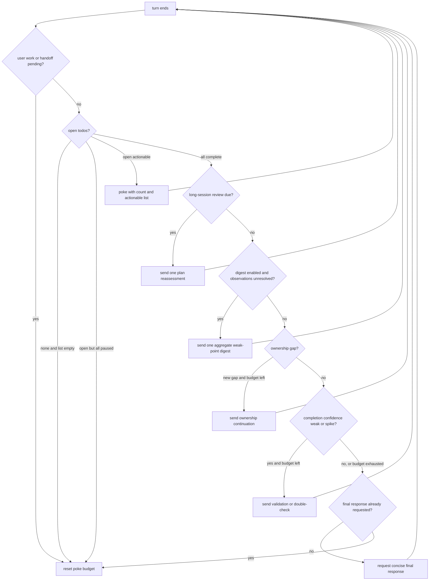

# Todo task list

Jcode's task list is three things working together:

1. a model-facing `todo` tool that writes a plan and per-item assessments;
2. per-session JSON state under `<jcode home>/todos/`;
3. a client-side turn-end policy that continues work the model stopped on.

The third part is what users notice as "the harness nudged the session". It
is not a provider feature. The TUI, the desktop/SDK clients, and headless
`jcode run` all read the same todo state and send a synthetic user-role
continuation when work remains.

For configuration only, see
[`TODO_FOLLOWUP_CONFIGURATION.md`](./TODO_FOLLOWUP_CONFIGURATION.md). This
document describes the whole mechanism.

## Model-facing surface

The tool is named `todo` and accepts reads and writes in one call. Its schema
lives in `crates/jcode-app-core/src/tool/todo.rs`.

### Plan hierarchy

Write a plan as **phases -> lanes -> items**:

```json
{
  "phases": [
    {
      "phase": 1,
      "lanes": [
        {
          "lane": "implementation",
          "items": [
            {
              "id": "implement",
              "content": "Implement the change",
              "status": "in_progress",
              "priority": "high",
              "confidence": "validated"
            }
          ]
        }
      ]
    }
  ]
}
```

Phases run in declared order. Lanes inside a phase may run in parallel. Items
inside a lane run in order. Each item inherits the phase as `stage` and the
lane as `group`; the saved format stays a flat `TodoItem` array so older
readers, swarm links, and rendering keep working.

Use `update` by `id` for status and field changes, `add` for new work, and
`remove` for deletion. Full `todos` replacement is for the initial plan or a
real restructure.

### Items

A `TodoItem` carries:

- `content`, `details`, `id`, `priority`;
- `status`: `pending`, `in_progress`, `completed`, `cancelled`;
- `confidence`: evidence that the item can be completed correctly;
- `completion_confidence`: evidence behind marking it complete;
- `confidence_history`: append-only, maintained by the tool;
- `waiting_on`: background task IDs or durable swarm await IDs;
- `external_blocker`: `{reason, review_at}` for an external wait;
- `completely_blocked`: `{reason}` when there is no way forward;
- `assigned_to`: set by swarm dispatch, not by the model.

Natural status synonyms such as `done` or `finished` are canonicalized on
write for older sessions. New tool calls advertise the constrained vocabulary.

### Plan-level and goal-level assessments

`plan` records what the user actually wants:

```json
{
  "plan": {
    "user_intention": "Ship a working task list that survives reload",
    "understands_user_intent": "clear"
  }
}
```

`goals` records one assessment per todo group:

- `closed_feedback_loop`: how much correctness the loop can verify on its own;
- `feedback_loop`: the requirement-to-check process;
- `feedback_loop_relevance`: indirect, synthetic, representative,
  acceptance blocked, or acceptance aligned;
- `feedback_loop_coverage`: narrow, main paths, or edge and integration paths;
- `feedback_loop_traceability`: unmapped, partial, or complete;
- `delivery_state`: change made, integrated, workflow validated, outcome
  delivered;
- `difficulty`, `autonomy`, `iteration_maturity`, `stopping_evidence`.

These fields drive turn-end gates. They are assessment metadata, not another
task list. Goals whose group no longer exists are pruned.

### Validation and derived state

On every write the tool:

- normalizes provider quirks such as stringified arrays and objects;
- merges `confidence_history` instead of trusting a model-supplied history;
- rejects unknown new `waiting_on` IDs and IDs owned by another session;
- subscribes delivery wakes for running background tasks and awaits;
- validates `external_blocker.review_at` as a future RFC3339 deadline;
- clears blocker fields when an item is no longer incomplete;
- records quality observations for the turn-end digest;
- updates session-title hints and telemetry.

## Storage

State is per session, outside the transcript:

| file | contents |
| --- | --- |
| `<home>/todos/<session>.json` | todo items |
| `<home>/todos/<session>-plan.json` | plan-level intent assessment |
| `<home>/todos/<session>-goals.json` | per-group goal assessments |
| `<home>/todos/<session>-gate-observations.json` | deferred weak points for this turn |
| `<home>/todos/<session>-review-state.json` | long-session review clock |
| `<home>/todos/<session>-lane-links.json` | swarm lane ownership |

`<home>` is `JCODE_HOME` or `~/.jcode`. Paths and readers live in
`crates/jcode-todo-policy/src/store.rs` and `crates/jcode-base/src/todo.rs`.

Because state is on disk, the pinned card, a TUI reload, a remote attach, an
SDK client, and a headless run all see the same list. Missing or unreadable
files are treated as empty state by tolerant readers.

## TUI presentation

- The pinned todo band is enabled by `display.pin_todos` (default `true`).
- `alt+x` or `/todos` opens the inline card. The transcript keeps at most one
  card and refreshes it when todo state changes.
- The card renders phases, lanes, worker status, background tasks, and blocker
  reasons. Live worker rows use the same status renderer as the session.
- On full completion, a display-only **Todo completion** report summarizes
  assessed weaknesses. It does not enqueue a model turn and does not depend on
  auto-poke or the gate digest.

## Turn-end follow-ups

The shared pure policy is `FollowUpPolicy` in
`crates/jcode-todo-policy/src/followup.rs`. The TUI has an equivalent in-app
scheduler in `crates/jcode-tui/src/tui/app/input.rs` with extra handling for
provider guardrails, remote windows, and queued dispatch.

Entry points:

- TUI local turn finish (`finish_turn`);
- TUI remote turn-end server events;
- headless `jcode run` loop;
- SDK clients calling `FollowUpPolicy::decide`.

### Preconditions

A follow-up is not scheduled when:

- a user prompt or another follow-up is already queued or pending;
- a cloud handoff owns the idle boundary;
- every open todo is paused (see below);
- auto-poke is disarmed;
- the provider refused two turns in a row (guardrail circuit breaker);
- the last turn failed with a non-retryable error;
- a completed todo fingerprint already received its final response and the
  todo state has not changed since.

### Decision order



The long-session review is checked before incomplete work. It is delivered
once per todo cycle after 30 minutes, and still counts as a review turn when
open work remains.

### Incomplete-todo poke

The continuation is built by `build_actionable_poke_message`:

```text
You have 3 incomplete todos. Continue working, or update the todo tool.
Actionable todos:
- implement: "Implement the change"
- verify: "Run the acceptance workflow"
```

It is persisted as a user-role message so the model treats it as a normal
continuation. The live UI hides the raw text and shows:

```text
👉 3 incomplete todos. We poked it for you. /poke off to stop.
```

On reload or peer attach, the same text is collapsed through
`auto_poke_display_summary`, with a count fallback when the message has no
named list.

An unchanged incomplete list gets at most three automatic attempts. Any change
to the actionable incomplete set resets the budget. A completed or empty list
ends the cycle. Open todos also reset the separate completion-gate budget.

### Paused work

These conditions suppress pokes for that item:

- `completely_blocked` with a non-empty reason. No timed review is scheduled;
  independent work continues.
- `external_blocker` with a future `review_at`. Pokes pause until that time,
  and a durable scheduler wakes the session to reassess. The wake never marks
  the item complete.
- `waiting_on` a background task or swarm await that is still running. A
  terminal dependency stops blocking.

If every open item is paused, the poke budget resets and no turn is sent.
Waiting is not treated as resistance and not treated as completion.

### Quality gates

Weak assessments recorded during todo writes become `GateObservation`s.
Observation kinds are intent understanding, closed feedback loop, feedback
relevance, feedback coverage, and feedback traceability. They are capped at
256 per cycle.

Most checks are deferred to turn end instead of interrupting the turn. The one
immediate exception is a first plan write whose
`understands_user_intent` is `uncertain`, because a whole turn spent on the
wrong task cannot be recovered later.

At turn end, with all work complete:

1. **Gate digest** (opt-in). One aggregate reminder covering every unresolved
   observation. Repeats collapse into a count. It is delivered once per cycle,
   then the observation log is cleared. If disabled, observations are cleared
   without a model turn.
2. **Ownership**. Checks actionable gaps in delivery state, iteration
   maturity, and stopping evidence. Each distinct ownership message is sent
   once. A documented stop with evidence is not treated as an ownership gap.
3. **Completion confidence**. Completed items need `validated` or better.
4. **Confidence spike**. A jump from speculative straight to verified is
   challenged once, so a bulk end-of-task stamp does not count as independent
   validation.
5. **Final response**. After the gates pass, the model gets one handoff to
   write a concise answer and stop calling the todo tool.

The completion gates share a five-turn budget per cycle. If the same gate
still fails after that, the client stops poking and shows:

```text
⚠️ We nudged the agent several times but its validation still isn't holding
up. We stopped poking; review the remaining todos yourself.
```

A new todo state re-arms poking.

## Configuration

| setting | default | effect |
| --- | --- | --- |
| `features.auto_poke` | `true` | arm turn-end follow-ups for new sessions |
| `features.todo_gate_digest` | `false` | send one aggregate weak-point digest per cycle |
| `display.pin_todos` | `true` | show the pinned todo band |
| `keybindings.auto_poke_toggle` | `ctrl+p` | toggle auto-poke |
| `keybindings.todo_card_toggle` | `alt+x` | toggle the inline card |

Session commands:

- `/todos` or `alt+x`: show the card.
- `/poke`: poke now if work remains.
- `/poke on`: arm auto-poke and reset the cycle.
- `/poke off`: disarm and clear queued poke continuations. Completion reports
  stay visible.
- `/poke status`: show whether auto-poke is armed.

`/poke off` and a gate circuit breaker both stick for the session. New open
work re-arms a circuit breaker only when auto-poke is still the configured
default.

## Headless and SDK

`jcode run` uses `features.auto_poke`, with `JCODE_RUN_AUTO_POKE=0` to override
it and `JCODE_RUN_AUTO_POKE_MAX_TURNS=N` to cap continuation turns. It sends
the same incomplete-todo, digest, completion-confidence, and confidence-spike
messages. It handles background and await dependencies before poking, and
prints blocker notices instead of waiting forever. It does not run the TUI
ownership gate.

SDK and desktop clients drive the pure policy:

```rust
let mut policy = jcode_sdk::todo::FollowUpPolicy::new(config.features.auto_poke);
policy.set_gate_digest_enabled(config.features.todo_gate_digest);

let decision = policy.decide(&snapshot);
if let Some(follow_up) = decision.follow_up {
    send_user_message(follow_up.message);
}
apply_effects(decision.effects);
```

`TodoSnapshot` carries the todos, plan, goals, gate observations, the
long-session review flag, and the IDs of running background tasks. Apply
`TodoEffects` through the client's normal acknowledgement path even when no
follow-up is produced.

## Code map

| piece | location |
| --- | --- |
| tool schema, validation, writes | `crates/jcode-app-core/src/tool/todo.rs` |
| item, plan, and goal types | `crates/jcode-task-types/src/lib.rs` |
| pure policy, gate definitions, messages | `crates/jcode-todo-policy/src/lib.rs` |
| turn-end state machine | `crates/jcode-todo-policy/src/followup.rs` |
| on-disk layout | `crates/jcode-todo-policy/src/store.rs` |
| runtime readers and writers | `crates/jcode-base/src/todo.rs` |
| TUI turn-end scheduler | `crates/jcode-tui/src/tui/app/input.rs` |
| TUI card and pinned band | `crates/jcode-tui/src/tui/app/todos_view.rs` |
| display-only completion report | `crates/jcode-tui/src/tui/app/todo_completion.rs` |
| headless loop | `src/cli/commands.rs`, `src/cli/commands/todo_followup.rs` |
| SDK entry point | `crates/jcode-sdk/src/lib.rs` |

## Related docs

- [`HARNESS.md`](./HARNESS.md): planning hierarchy, blockers, worker lanes,
  feedback-loop assessments.
- [`TODO_FOLLOWUP_CONFIGURATION.md`](./TODO_FOLLOWUP_CONFIGURATION.md):
  digest opt-in and SDK policy configuration.
- [`MESSAGE_VOICE.md`](./MESSAGE_VOICE.md): user-facing wording rules.
- [`SWARM_ARCHITECTURE.md`](./SWARM_ARCHITECTURE.md): worker lane assignment.
